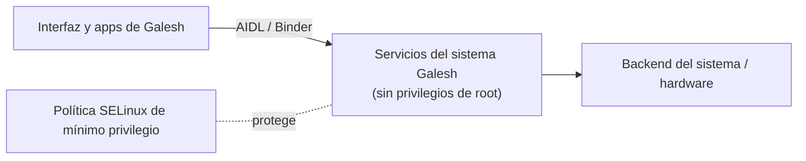

  

# Galesh OS

**Sistema operativo móvil basado en Android (AOSP 14), desarrollado en Paraguay.**

[Sitio web](https://ashb-official.github.io/Galesh_OS/) · [Pitch deck (PDF)](docs/Galesh_OS_Pitch_Deck_2026.pdf) · [Licencia](LICENSE)

> **Estado:** en desarrollo activo. 10 de los 20 módulos de la Beta 1.0 validados y congelados en emulador (AOSP 14). Beta pública prevista para **2027** (imagen para emulador).
> Este repositorio es la presentación pública del proyecto. El código fuente de Galesh OS es propietario y no se publica aquí.

---

## Qué es Galesh OS

Galesh OS es un sistema operativo móvil construido sobre AOSP con una capa propia de servicios del sistema, interfaz y aplicaciones. Su objetivo es ofrecer un sistema rápido, eficiente con la batería y respetuoso con la privacidad, con funciones propias integradas en el sistema y no como aplicaciones añadidas.

## Componentes principales

| Componente | Qué hace | Estado |
|---|---|---|
| **Control Center** | Panel central para ver y ajustar el rendimiento, la batería y los modos del sistema. | Validado en emulador |
| **Game Turbo** | Sesiones de juego con un perfil de rendimiento dedicado que se cierra solo al terminar el juego. | Validado en emulador |
| **Battery Guard** | Supervisión del estado de protección de la batería, integrada en el sistema. | Validado en emulador |
| **System Control** | Servicio central del sistema, sin privilegios de root; coordina los demás servicios. | Validado en emulador |
| **Clasificador de hardware (AHC)** | Detecta la capacidad del equipo y adapta los perfiles del sistema. | Validado en emulador |
| **Motor ACE 0.1** | Supervisión de hardware, consumo, carga de juegos y temperatura; solo observa en esta versión. | Validado en emulador |
| **Inicio** | Pantalla de inicio propia con el concepto visual de Galesh OS. | Validado en emulador |
| **Identidad de arranque** | Logo y animación de arranque propios. | Validado en emulador |
| **Quick Panel** | Panel de ajustes rápidos con el tema del sistema; el rediseño llega después de la Beta. | En porte al árbol AOSP 14 (paso actual) |
| **Touch & Connect** | Emparejamiento de dispositivos tocándolos entre sí. Hoy entre teléfonos; PC, relojes, auto y TV en el plan. | Servicio validado en emulador; interfaz después de la Beta |
| **Quari Store** | Tienda de aplicaciones curada, con catálogo firmado; la compatibilidad opcional con microG llega después de la Beta. | Versión mínima validada en emulador; versión completa en desarrollo |
| **Asistente de bienvenida** | Configuración inicial del sistema con identidad Galesh. | En desarrollo |

«Validado en emulador» = módulo cerrado y congelado en el árbol AOSP 14, con evidencia de compilación y pruebas en ejecución. La Beta 1.0 abarca 20 módulos, 10 ya validados; Task Space llega después de la Beta y Machine Explorer queda fuera de la imagen.

## Arquitectura (resumen)

Principios de diseño:

- **Servicios sin root:** cada servicio corre con la identidad mínima necesaria.
- **Permisos por firma:** solo los componentes autorizados del sistema acceden a cada servicio.
- **SELinux estricto:** política de mínimo privilegio, sin modos permisivos.
- **Nada a medias:** las funciones incompletas permanecen desactivadas hasta validarse.
- **Validación por etapas:** cada módulo pasa auditoría, compilación, pruebas en ejecución y congelado antes de considerarse terminado.

## Hoja de ruta

| Versión | Fecha prevista | Contenido |
|---|---|---|
| **Beta 1.0** | 2027 | Imagen para emulador con los componentes principales, tema Galesh y Quari Store. |
| **1.1** | 2027 | Rediseño de la pantalla de bloqueo y las notificaciones; primer dispositivo físico (en evaluación). |
| **1.2** | 2027 | Rediseño de recientes, volumen y menú de apagado. |
| **Después** | — | Task Space y Touch & Connect multidispositivo. |

## Inversionistas y socios

El código fuente está disponible para revisión técnica **bajo acuerdo de confidencialidad (NDA)**, junto con una demostración en vivo del sistema. Contacto: [contact@ashbtechnology.tech](mailto:contact@ashbtechnology.tech) · [ashbtechnology.tech/galeshos](https://ashbtechnology.tech/galeshos/).

## Licencia

© 2026 Gabriel Alexander Sharp Brizuela. Todos los derechos reservados.

Galesh OS se basa en el Android Open Source Project (AOSP). Los componentes de AOSP conservan sus licencias originales (Apache 2.0 y otras). Los componentes propios de Galesh OS son propietarios.

---

### English summary

Galesh OS is a mobile operating system built on AOSP 14, developed in Paraguay, with its own system services, interface and apps focused on performance, battery efficiency and privacy. It is under active development; the public beta (emulator image) is planned for 2027. The source code is proprietary and available for technical review under NDA.
